I'm a software engineer in Glasgow. I spent five years at Cisco working on networking, software and automation.

[Portfolio](https://jamieblair.co.uk) · [LinkedIn](https://www.linkedin.com/in/jamie-blair-glasgow/)

## Independent projects

### [Faultline](https://github.com/weegienamja/Faultline-Network-Diagnostics)

When a connection works over IPv4 but fails over IPv6, Faultline tests both paths and saves the results for the next person investigating. [Run it locally](https://github.com/weegienamja/Faultline-Network-Diagnostics#run-locally)

### [SwitchOps](https://github.com/weegienamja/Switch-Ops)

A Windows app for Cisco Catalyst switches. Inspect a port, review a proposed change, then compare the switch state before and after. [Windows installer](https://github.com/weegienamja/Switch-Ops/releases/latest)

### [Cisco vManage MCP Server](https://github.com/weegienamja/sdwan-mcp-server)

Gives AI assistants read-only access to Cisco SD-WAN. Ask which tunnels are unhealthy or which alarms might have a common cause.

### [WindForge](https://github.com/weegienamja/WindForge)

Pick a potential wind site to see how wind, terrain and grid access affect its screening score. If required data is missing, WindForge shows the gap and withholds the score. [Try the demo](https://windforge.khmer-iq.workers.dev/)
